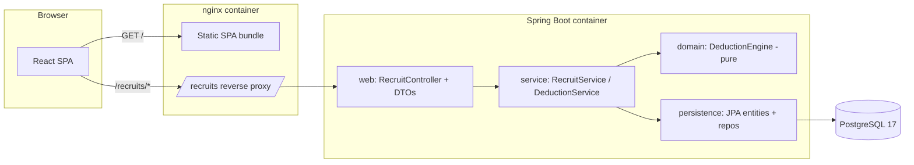

# CFB Recruiter

A personal, local-only tool for cracking the **hard-sell pitch** of recruits in
*EA Sports College Football 26*. You feed it what you've scouted about a
recruit's hidden motivations; it tells you — the moment it's knowable — exactly
which of the game's 20 pitches will land.

> **Unofficial fan tool.** Not affiliated with, endorsed by, or using any assets
> from EA Sports. All pitch/motivation data is original data entry based on
> observed in-game mechanics.

---

## Table of contents

- [What problem it solves](#what-problem-it-solves)
- [How the deduction works](#how-the-deduction-works)
- [Screens](#screens)
- [Tech stack](#tech-stack)
- [Architecture](#architecture)
- [Running it](#running-it)
- [API reference](#api-reference)
- [Project layout](#project-layout)
- [Design decisions & trade-offs](#design-decisions--trade-offs)
- [Testing](#testing)
- [Roadmap / not yet built](#roadmap--not-yet-built)

---

## What problem it solves

In CFB 26, every recruit has **3 hidden motivations** drawn from a fixed pool of
**14 categories** (Academic Prestige, Playing Time, Pro Potential, Proximity To
Home, …). The game also defines **20 named "pitches"** (Hometown Hero, Gym Rat,
The Clutch, …), and each pitch maps to exactly one triplet of those categories.
If you pitch a recruit with a story that matches all 3 of their true
motivations, it's a **hard sell** — the strongest possible recruiting move.

The catch: you don't see a recruit's motivations up front. You *scout* them one
at a time, learning that a category is either **confirmed** (it's one of their
3) or **ruled out** (it isn't). Mentally cross-referencing partial information
against 20 pitches every time you scout someone is tedious and error-prone.

This app does that cross-referencing for you, live, across your whole board.

## How the deduction works

The core is a **pure set-elimination engine** — no scoring, no ranking, no
machine learning. It's deterministic logic you can reason about:

1. Start with all 20 pitches as candidates.
2. A pitch **survives** only if it contains **every confirmed** motivation *and*
   **none of the ruled-out** ones. Unknown categories don't constrain anything.
3. Recompute from scratch on every scouting change.

The number of survivors is the whole answer:

| Survivors | Meaning | In the UI |
|-----------|---------|-----------|
| **1** | Hard sell is locked — this is the pitch | Green "hard sell ready" banner + confirmed tile |
| **2+** | Not enough info yet; keep scouting | Remaining pitches shown as "possible" |
| **0** | Contradiction — should be impossible | All tiles eliminated (see note below) |

Because nothing derived is ever stored — the result is a pure function of the
current motivation toggles — **every scouting call is freely reversible**.
Mis-scouted someone? Flip the toggle back and the whole board recomputes. There
is no accumulated state to unwind.

<details>
<summary><strong>A subtle correctness note worth knowing</strong></summary>

The engine trusts its inputs, and the two kinds of mistake fail differently:

- A **wrong confirm** over-constrains and usually collapses the field to **0
  candidates** — a loud, self-correcting error signal.
- A **wrong rule-out** can silently eliminate the recruit's *real* pitch and
  leave exactly one *wrong* survivor — a confident, green, and incorrect "ready."

So a rule-out deserves as much care as a confirm. And a 0-candidate result is
genuinely *ambiguous*: it means **either** a bad toggle **or** a gap/typo in the
20-pitch seed data. When it fires, the seed table is as suspect as your input.

</details>

The engine itself is deliberately framework-free — plain Java working on
`Set<MotivationCategory>` — so it's trivial to unit-test in isolation
([`DeductionEngine.java`](backend/src/main/java/io/github/jamesg1996/cfbrecruiter/domain/deduction/DeductionEngine.java)).

## Screens

A deliberately minimal two-view UI. Everything is greyscale **except** the
readiness signal, because that's the one thing that matters at a glance.

- **Board** — every recruit as a card: name, position, recruiting class,
  national ranking, a 1–5 pipeline-grade dot meter, and their confirmed pitch
  (with icon) if one is locked. A create form adds new recruits inline.
- **Recruit detail** — a 5×4 icon grid of all 20 pitches (confirmed / possible /
  eliminated), a prominent hard-sell banner when a pitch locks, and a 3-way
  toggle (`CONFIRM` / `RULE OUT` / `UNKNOWN`) for each of the 14 motivation
  categories. Every toggle re-evaluates the grid immediately.

## Tech stack

| Layer | Choices |
|-------|---------|
| **Backend** | Java 25, Spring Boot 4.1 (Web MVC, Data JPA, Bean Validation, Actuator), Flyway migrations, springdoc OpenAPI (Swagger UI), Spring Boot DevTools |
| **Database** | PostgreSQL 17 |
| **Frontend** | React 19, TypeScript 6, Vite 8, oxlint — no UI kit, no state library (just hooks + `fetch`) |
| **Packaging** | Multi-stage Docker builds; nginx serving the SPA and reverse-proxying the API; Docker Compose for one-command startup |
| **Testing** | JUnit 5, Testcontainers (real Postgres 17), Spring Boot `@DataJpaTest` / `MockMvc`, service-connection auto-wiring |

Notable build glue:

- **Flyway** owns the schema (`V1` creates tables, `V2` seeds the 20 pitches), so
  the database is reproducible from migrations rather than JPA `ddl-auto`.
- **`spring-boot-docker-compose`** auto-starts a local Postgres from
  [`backend/compose.yaml`](backend/compose.yaml) when you run the backend
  outside Docker — no manual DB setup for local dev.

## Architecture

A single monorepo with a cleanly layered backend. The deduction logic lives in a
**pure domain layer** with no Spring or JPA dependencies; persistence, service,
and web layers wrap around it.



Request flow for a scouting toggle: the SPA `PUT`s a motivation status →
`RecruitController` → `RecruitService` persists the assertion → the next
`GET /recruits/{id}/evaluation` has `DeductionService` load the 20 pitches +
that recruit's statuses and run them through the pure `DeductionEngine`.

The backend layering maps to packages under
[`io.github.jamesg1996.cfbrecruiter`](backend/src/main/java/io/github/jamesg1996/cfbrecruiter):

- `domain` / `domain.deduction` — enums, `Pitch`, `ScoutingState`, and the
  engine. Pure Java, framework-free, fully unit-tested.
- `persistence` — JPA `@Entity` classes, Spring Data repositories, and mappers
  that translate entities ↔ domain records.
- `service` — transactions + orchestration (load pitches, build scouting state,
  evaluate).
- `web` — REST controller, request/response DTO records, `@RestControllerAdvice`
  returning RFC 7807 `ProblemDetail` responses.

## Running it

### Everything, one command (Docker)

Requires Docker Desktop.

```bash
docker compose up --build
```

This starts three containers — Postgres, the Spring Boot backend, and an nginx
frontend — wired together with a healthcheck gate so the backend only starts
once the database is ready.

Then open **http://localhost:8080**.

Postgres data lives in a **named volume** (`pgdata`), so it survives
`docker compose down`. To wipe it, add `-v`.

### Local development (hot reload)

Run the two halves separately for fast feedback loops.

**Backend** (auto-starts a Postgres container via Spring Boot's Docker Compose
support; serves on `:8081`):

```bash
cd backend
./mvnw spring-boot:run
```

**Frontend** (Vite dev server on `:5173`, proxying `/recruits` → `:8081`):

```bash
cd frontend
npm install
npm run dev
```

Handy backend URLs in dev:

- Swagger UI — http://localhost:8081/swagger-ui.html
- OpenAPI JSON — http://localhost:8081/v3/api-docs
- Actuator — http://localhost:8081/actuator

## API reference

All endpoints are under `/recruits`. Full interactive docs via Swagger UI above.

| Method | Path | Purpose |
|--------|------|---------|
| `GET` | `/recruits` | List recruits (summary + confirmed pitch, if locked) |
| `POST` | `/recruits` | Create a recruit → returns new id (`201`) |
| `GET` | `/recruits/{id}` | Recruit detail incl. per-category motivation statuses |
| `DELETE` | `/recruits/{id}` | Delete a recruit (`204`) |
| `PUT` | `/recruits/{id}/motivations/{category}` | Set a category to `CONFIRMED` / `RULED_OUT` / `UNKNOWN` (`204`) |
| `GET` | `/recruits/{id}/evaluation` | Run the deduction → list of pitches with `ELIMINATED` / `POSSIBLE` / `CONFIRMED` status |

## Project layout

```
cfb-recruiter/
├── compose.yaml                # 3-service prod-ish stack (postgres + backend + frontend)
├── backend/                    # Spring Boot app
│   ├── Dockerfile              # multi-stage: Temurin 25 JDK build → JRE runtime
│   ├── compose.yaml            # local-dev Postgres (auto-started by Spring Boot)
│   └── src/main/
│       ├── java/.../cfbrecruiter/
│       │   ├── domain/         # enums, Pitch, deduction engine (pure)
│       │   ├── persistence/    # JPA entities, repositories, mappers
│       │   ├── service/        # transactions + orchestration
│       │   └── web/            # REST controller + DTOs + error handling
│       └── resources/db/migration/   # Flyway: V1 schema, V2 seed 20 pitches
├── frontend/                   # React + Vite SPA
│   ├── Dockerfile              # multi-stage: node build → nginx:alpine
│   ├── nginx.conf              # serves SPA, proxies /recruits to backend
│   └── src/                    # App.tsx (board + detail), api.ts (typed client)
└── docs/
    └── cfb26-recruiting-notes.md   # full design record (the "why" behind everything)
```

## Design decisions & trade-offs

The long-form reasoning lives in
[`docs/cfb26-recruiting-notes.md`](docs/cfb26-recruiting-notes.md). The headlines:

- **Set elimination, not scoring.** The game constrains every recruit to one of
  just 20 of the C(14,3)=364 possible triplets. That turns "which pitch?" into a
  clean constraint-satisfaction problem rather than a heuristic one — the engine
  is sound and complete *under the assumption that the true triplet is always one
  of the 20 seeded pitches*. See the correctness note above for where that
  assumption bites.

- **Derived, never stored.** A recruit's "true pitch" is never persisted; it's
  recomputed from the current toggles on demand. This is what makes every
  scouting call reversible and keeps the single source of truth the user's raw
  assertions — no stale derived state to reconcile.

- **Pure domain core.** The engine has zero framework dependencies, so it's
  testable as plain Java and the Spring/JPA machinery stays at the edges.

- **Postgres over H2.** Docker removes the setup-friction argument for an
  embedded DB, and running the same engine (Postgres 17) in dev, test
  (Testcontainers), and "prod" compose avoids environment drift.

- **Flyway-owned schema + seed data.** Pitches are seed data in a migration
  rather than hardcoded, so the game-fact table is versioned and reproducible,
  and `ddl-auto` never silently reshapes the schema.

- **Separate nginx container instead of a bundled jar.** The original plan was to
  bundle the React build into the Spring Boot jar for a single artifact. The
  implementation deliberately went the other way: an nginx container that serves
  the static SPA and reverse-proxies `/recruits` to the backend. It keeps the two
  build toolchains independent, mirrors a realistic web topology, and means the
  frontend and backend scale/deploy as separate images. The small cost is a third
  container and an extra proxy hop.

- **Monorepo, not split repos.** One app, one developer, no independent deploy
  targets — separate repos would only add overhead. Splitting later is a
  mechanical git move, not a design lock-in.

## Testing

Tests run against a **real Postgres 17** via Testcontainers, not an in-memory
substitute — so JPA mappings, Flyway migrations, and enum/collection handling are
exercised exactly as they run in production:

- **`DeductionEngineTest`** — pure unit tests covering the states that matter:
  one survivor via confirms, one survivor via eliminations alone, multiple
  survivors, zero survivors, and a fresh (all-unknown) recruit.
- **Repository tests** (`@DataJpaTest` + Testcontainers) — verify entity ↔ domain
  round-trips and the motivation collection mapping.
- **Service & controller tests** (`@SpringBootTest` + `MockMvc`) — cover the HTTP
  surface and end-to-end evaluation through the real wiring.

```bash
cd backend
./mvnw test
```

> Note (Spring Boot 4.1): Testcontainers is pinned to 2.0.x, whose module
> artifacts are renamed with a `testcontainers-` prefix and whose container
> classes moved to per-module packages (e.g.
> `org.testcontainers.postgresql.PostgreSQLContainer`).

## Roadmap / not yet built

The design notes describe a larger tool than what's currently implemented. These
pieces are **designed but not yet built**:

- **Region-keyed pipeline grades.** Pipeline grade is currently a plain 1–5
  integer per recruit. The design calls for a single global, region-keyed
  `RegionPipeline` lookup (regions created lazily) decoupled from any
  recruit/season.
- **Annual class wipe with selective retention.** Planned `season` + `status`
  (`ACTIVE` / `RETAINED`) fields would let a yearly wipe clear active recruits
  while keeping fully-scouted players (e.g. transfer-portal targets) with their
  motivation data intact. Not yet modeled.
- **Dealbreaker motivation.** The design treats one of the 3 motivations as a
  "dealbreaker" that's confirmed by default and locked in the UI. Currently all
  14 categories start unknown.
- **Richer readiness signaling.** Explicit amber/grey/red board badges
  (`0 candidates — check data`) and an eliminated-with-reason list (which category
  ruled each pitch out) are described in the wireframe but not implemented.
